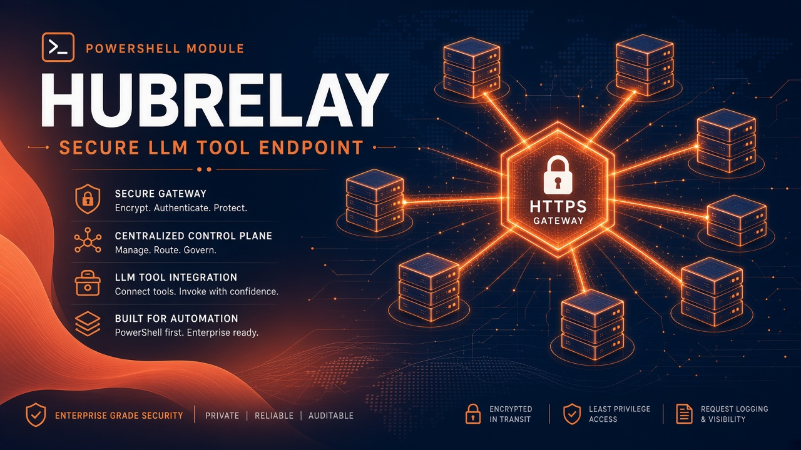
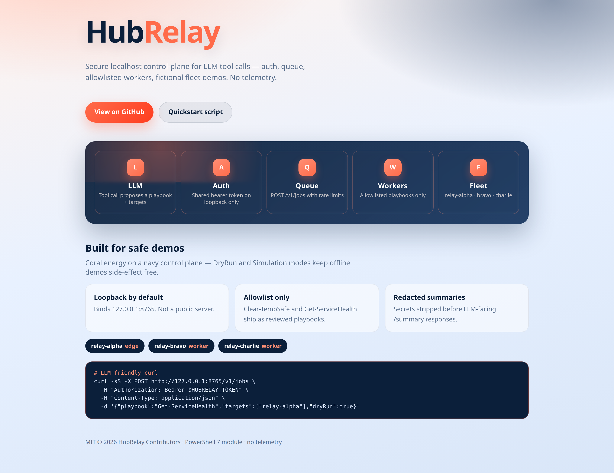

# HubRelay

[](https://github.com/PowerShell/PowerShell)
[](LICENSE)
[](src/HubRelay/HubRelay.psd1)
[](SECURITY.md)

Secure **localhost** control-plane for LLM tool calls — allowlisted playbooks, bearer auth, rate limiting, and redacted summaries.



## What it does

HubRelay is a PowerShell 7 module that also hosts a small HTTP listener (default `http://127.0.0.1:8765/`) so LLM agents can enqueue jobs safely:

```
LLM  →  Auth  →  Queue  →  Workers  →  Fleet
```



**Marketing demo (static):** open [`demo/index.html`](demo/index.html) in a browser.

## Install

```powershell
git clone https://github.com/btstevens1984az/HubRelay.git
Import-Module ./HubRelay/src/HubRelay/HubRelay.psd1
```

Requires **PowerShell 7.0+**. No telemetry. Author: HubRelay Contributors.

## Quick start

```powershell
# Prefer env for the shared secret — never commit tokens
$env:HUBRELAY_TOKEN = 'replace-with-a-long-random-secret'

Start-HubRelay -Port 8765 -Simulation   # loopback only

# In-process (no HTTP required)
$job = New-HubJob -Playbook Get-ServiceHealth -DryRun -Targets relay-alpha,relay-bravo
Get-HubJobSummary -Id $job.Id

Test-HubRelay
Stop-HubRelay
```

See [`examples/quickstart.ps1`](examples/quickstart.ps1) and [`examples/sample-job.json`](examples/sample-job.json).

## HTTP API (LLM tools)

All routes require `Authorization: Bearer $HUBRELAY_TOKEN`.

| Method | Path | Purpose |
|--------|------|---------|
| `POST` | `/v1/jobs` | Create & run an allowlisted job |
| `GET`  | `/v1/jobs/{id}` | Full job record |
| `GET`  | `/v1/jobs/{id}/summary` | Redacted summary for LLM context |
| `GET`  | `/v1/health` | Liveness |

### curl examples

```bash
export HUBRELAY_TOKEN='replace-with-a-long-random-secret'
BASE=http://127.0.0.1:8765

# Health
curl -sS -H "Authorization: Bearer $HUBRELAY_TOKEN" "$BASE/v1/health"

# Enqueue a dry-run health check on fictional hosts
curl -sS -X POST "$BASE/v1/jobs" \
  -H "Authorization: Bearer $HUBRELAY_TOKEN" \
  -H "Content-Type: application/json" \
  -d @examples/sample-job.json

# Fetch redacted summary (replace JOB_ID)
curl -sS -H "Authorization: Bearer $HUBRELAY_TOKEN" \
  "$BASE/v1/jobs/JOB_ID/summary"
```

### Sample job body

```json
{
  "playbook": "Get-ServiceHealth",
  "targets": ["relay-alpha", "relay-bravo", "relay-charlie"],
  "dryRun": true,
  "parameters": { "ServiceName": "hubrelay-agent" }
}
```

## Allowlisted playbooks

| Playbook | Purpose |
|----------|---------|
| `Clear-TempSafe` | Clears only `*.tmp` / `*.log` under `/tmp/hubrelay-scratch/<target>` |
| `Get-ServiceHealth` | Offline-friendly health snapshot for a fictional target |

Unknown playbooks are rejected. Extend the allowlist only after review.

## Security

- **Loopback bind** (`127.0.0.1`) by default — not a public server
- **Bearer token** via `HUBRELAY_TOKEN` or `-Token` (never commit)
- **Allowlist-only** execution
- **In-memory rate limit** (default 60 req/min)
- **Result redaction** before `/summary`
- **DryRun** / **Simulation** for safe demos
- **No telemetry**

Details: [`SECURITY.md`](SECURITY.md).

## Module commands

| Command | Description |
|---------|-------------|
| `Start-HubRelay` | Start localhost listener |
| `Stop-HubRelay` | Stop listener |
| `New-HubJob` | Create/run job in-process |
| `Get-HubJob` | Get job or list recent |
| `Get-HubJobSummary` | Redacted summary |
| `Test-HubRelay` | Smoke tests |

## License

MIT © 2026 HubRelay Contributors — see [`LICENSE`](LICENSE).
