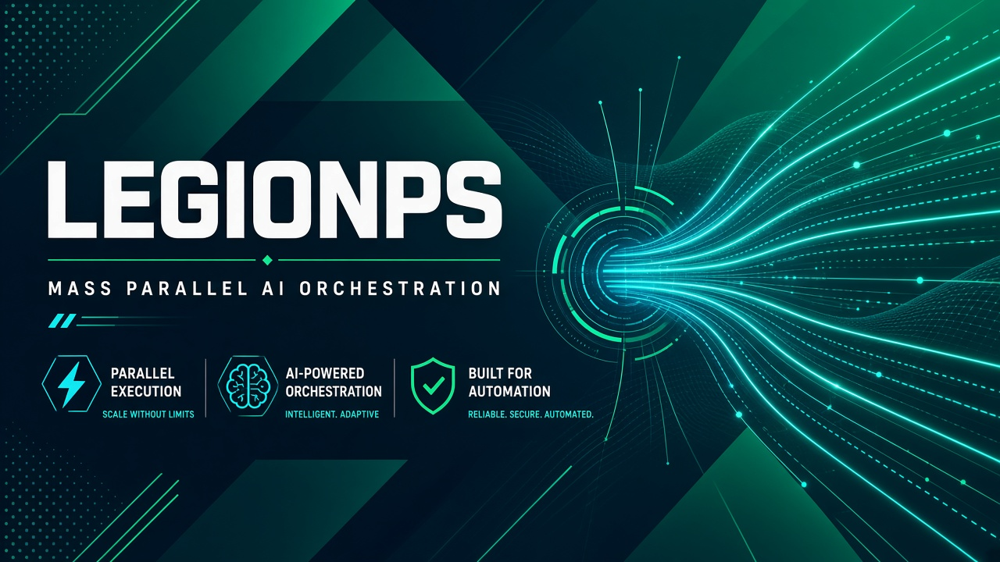
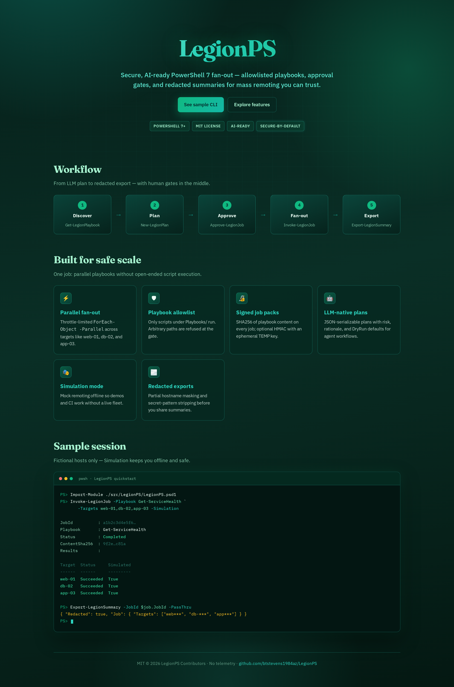
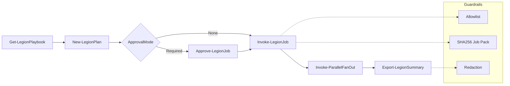

# LegionPS

<p align="center">
  
</p>

<p align="center">
  
  
  
  
  
</p>

**LegionPS** is a PowerShell 7 module for **secure, mass-parallel playbook fan-out** — built for operators and LLM tool-use. Allowlisted playbooks only, approval gates, dry-run/simulation, signed job packs, and redacted summaries. **No telemetry.**

> Demo hosts in docs are fictional: `web-01`, `db-02`, `app-03`.

<p align="center">
  
</p>

Visual walkthrough: open [`demo/index.html`](demo/index.html) in a browser.

---

## Install

```powershell
git clone https://github.com/btstevens1984az/LegionPS.git
cd LegionPS
Import-Module ./src/LegionPS/LegionPS.psd1 -Force
Get-Command -Module LegionPS
```

Requires **PowerShell 7.0+** (Core edition).

---

## Quick Start

```powershell
# List allowlisted playbooks
Get-LegionPlaybook

# Offline simulation against fictional hosts
Invoke-LegionJob -Playbook Get-ServiceHealth `
  -Targets web-01,db-02,app-03 `
  -Simulation -ThrottleLimit 4

# Plan only (no execution)
Invoke-LegionJob -Playbook Restart-Spooler -Targets web-01 -DryRun -Simulation

# Approval-gated run
$job = Invoke-LegionJob -Playbook Clear-TempSafe `
  -Targets app-03 -ApprovalMode Required -Simulation -UseHmac
Approve-LegionJob -JobId $job.JobId -Approver 'ops-lead'
Invoke-LegionJob -JobId $job.JobId -Simulation

# Redacted JSON for sharing / LLM context
Export-LegionSummary -JobId $job.JobId -Path ./summary.json
```

Or run the colorful demo:

```powershell
./examples/quickstart.ps1
```

---

## LLM tool-use notes

LegionPS is shaped for agent/LLM orchestration:

| Step | Cmdlet | Role |
|------|--------|------|
| 1 | `Get-LegionPlaybook` | Discover allowlisted tools |
| 2 | `New-LegionPlan` | Emit a JSON-serializable plan (`SchemaVersion`, targets, risk, rationale) |
| 3 | Human / policy review | Inspect plan before execute |
| 4 | `Invoke-LegionJob` | DryRun → Simulation → live |
| 5 | `Approve-LegionJob` | Gate when `ApprovalMode = Required` |
| 6 | `Export-LegionSummary` | Redacted artifact back into the model context |

Example plan payload an LLM can produce:

```json
{
  "SchemaVersion": "1.0",
  "Playbook": "Get-ServiceHealth",
  "Targets": ["web-01", "db-02"],
  "ApprovalMode": "Required",
  "Risk": "low",
  "Rationale": "Pre-change health check on demo fleet",
  "DryRunDefault": true
}
```

---

## Security model

- **Allowlist only** — scripts must live under `src/LegionPS/Playbooks/`; arbitrary paths are refused.
- **ApprovalMode** — `None` or `Required` (pending until `Approve-LegionJob`).
- **Signed job packs** — SHA256 of playbook content on every job; optional HMAC via ephemeral key under the process temp `LegionPS/` folder (never committed).
- **Redaction** — partial hostname masking + secret-pattern stripping on export.
- **No telemetry** — nothing phones home.
- See [SECURITY.md](SECURITY.md) for reporting and operational guidance.

---

## Architecture

```
                    ┌─────────────────────┐
                    │  Operator / LLM     │
                    │  New-LegionPlan     │
                    └─────────┬───────────┘
                              │
                              ▼
┌──────────────┐    ┌─────────────────────┐    ┌──────────────────┐
│ Playbooks/   │───▶│ Assert-Allowlist    │───▶│ New-JobPack      │
│ (allowlist)  │    │                     │    │ SHA256 / HMAC    │
└──────────────┘    └─────────────────────┘    └────────┬─────────┘
                                                        │
                         ┌──────────────────────────────┼──────────────────┐
                         ▼                              ▼                  ▼
                 ApprovalMode=Required          ApprovalMode=None    DryRun / Simulation
                         │                              │                  │
                         ▼                              ▼                  ▼
                 Approve-LegionJob ────────▶ Invoke-ParallelFanOut ◀───────┘
                                                    │
                                                    ▼
                                           Export-LegionSummary
                                              (redacted JSON)
```



---

## Module layout

```
src/LegionPS/
  LegionPS.psd1 / LegionPS.psm1
  Public/     Invoke-LegionJob, New-LegionPlan, Approve-LegionJob,
              Get-LegionPlaybook, Get-LegionJob, Export-LegionSummary
  Private/    Assert-Allowlist, Invoke-ParallelFanOut, Redact-Result, New-JobPack
  Playbooks/  Restart-Spooler, Get-ServiceHealth, Clear-TempSafe
```

---

## Tests

```powershell
/tmp/pwsh-install/pwsh -NoProfile -File ./tests/LegionPS.Tests.ps1
```

---

## License

MIT © 2026 LegionPS Contributors — see [LICENSE](LICENSE).
