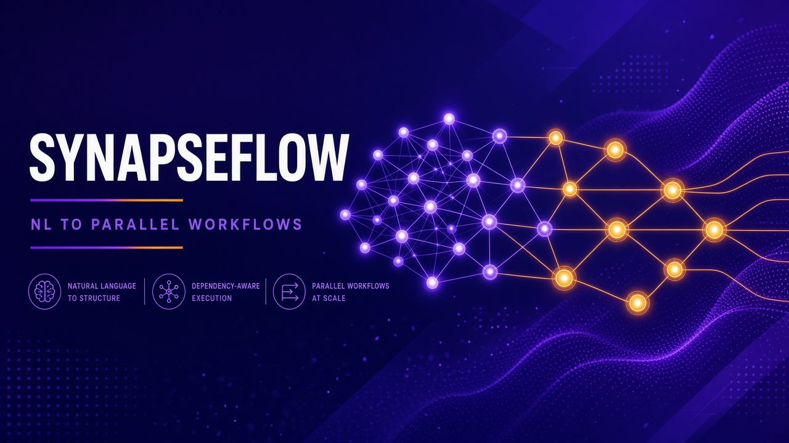
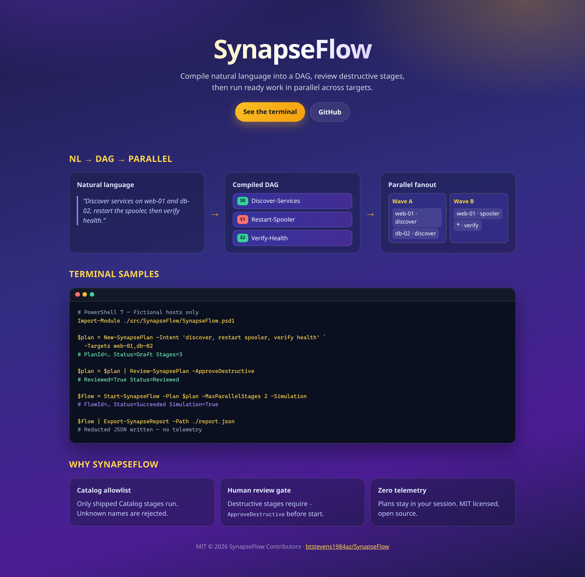

# SynapseFlow

[](https://github.com/PowerShell/PowerShell)
[](LICENSE)
[](src/SynapseFlow/SynapseFlow.psd1)
[](SECURITY.md)



**Intent → DAG → parallel stages.** SynapseFlow is a PowerShell 7 module that compiles natural-language intents (or LLM-supplied stage lists) into a JSON-serializable DAG, gates destructive work behind human review, then runs ready stages in parallel across fictional or declared targets.



Open the colorful marketing demo: [`demo/index.html`](demo/index.html)

---

## Install

```powershell
git clone https://github.com/btstevens1984az/SynapseFlow.git
Import-Module ./SynapseFlow/src/SynapseFlow/SynapseFlow.psd1
```

Requires **PowerShell 7.0+**. No telemetry. No network calls from the module itself.

---

## Quick start

```powershell
# 1. Compile a plan from intent (keyword → Catalog mapping)
$plan = New-SynapsePlan `
    -Intent 'discover services, restart spooler, then verify health' `
    -Targets @('web-01', 'db-02')

# 2. Human review — destructive stages need explicit approval
$plan = $plan | Confirm-SynapsePlan -ApproveDestructive

# 3. Execute ready stages in parallel (simulation-safe)
$flow = Start-SynapseFlow -Plan $plan -MaxParallelStages 2 -Simulation

# 4. Inspect & export a redacted report
Get-SynapseFlow -FlowId $flow.FlowId
$flow | Export-SynapseReport -Path ./report.json
```

See [`examples/quickstart.ps1`](examples/quickstart.ps1).

---

## How it works

```
Intent / LLM stages
        │
        ▼
 New-SynapsePlan  ──►  DAG (JSON-serializable)
        │
        ▼
 Confirm-SynapsePlan  ──►  Reviewed (+ ApproveDestructive if needed)
        │
        ▼
 Start-SynapseFlow  ──►  parallel waves (MaxParallelStages)
        │                    └─ per-stage fanout to Targets
        ▼
 Get-SynapseFlow / Export-SynapseReport / Repair-SynapseFlow
```

| Cmdlet | Role |
|--------|------|
| `New-SynapsePlan` | Intent heuristic or explicit `-Stages` → DAG |
| `Confirm-SynapsePlan` | Marks Reviewed; `-ApproveDestructive` for risky stages |
| `Start-SynapseFlow` | Runs ready stages in parallel; `-Simulation` fanout |
| `Get-SynapseFlow` | Session flow lookup |
| `Repair-SynapseFlow` | Regenerates failed / skipped branches |
| `Export-SynapseReport` | Redacted JSON report |

### Catalog allowlist (only)

| Stage | Destructive | Purpose |
|-------|-------------|---------|
| `Discover-Services` | No | Synthetic service discovery |
| `Restart-Spooler` | **Yes** | Spooler restart (simulation or live flag) |
| `Verify-Health` | No | Synthetic health checks |

Unknown stage names are rejected by `Assert-StageCatalog`.

---

## LLM usage

An LLM can skip the heuristic and pass an explicit stage graph:

```powershell
$stages = @(
    @{ Name = 'Discover-Services'; Targets = @('web-01', 'db-02') }
    @{ Name = 'Restart-Spooler';   DependsOn = @('stage-0'); Targets = @('web-01') }
    @{ Name = 'Verify-Health';     DependsOn = @('stage-1'); Targets = @('web-01', 'db-02') }
)

$plan = New-SynapsePlan -Stages $stages
$plan = $plan | Confirm-SynapsePlan -ApproveDestructive
$flow = Start-SynapseFlow -Plan $plan -Simulation
```

Guidance for agents:

1. Emit **only** Catalog stage names.
2. Use fictional hosts (`web-01`, `db-02`) unless the operator supplies targets.
3. Always surface the plan for `Confirm-SynapsePlan` before start.
4. Prefer `-Simulation` until a human approves live execution.

---

## Security

- Catalog allowlist only — no arbitrary script stages.
- Destructive stages blocked without `-ApproveDestructive`.
- `Export-SynapseReport` redacts emails, home paths, and common secret patterns.
- **No telemetry.** Plans stay in the local session registry.

Details: [`SECURITY.md`](SECURITY.md).

---

## Tests

```powershell
pwsh -File ./tests/SynapseFlow.Tests.ps1
```

---

## License

MIT © 2026 SynapseFlow Contributors — see [`LICENSE`](LICENSE).
